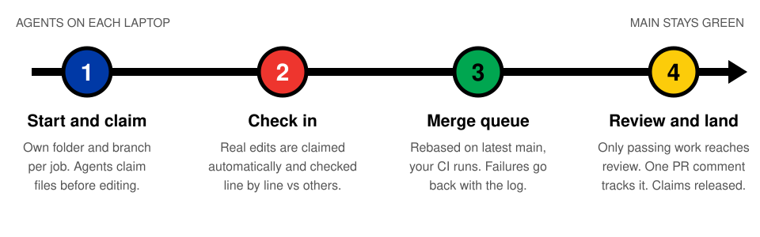
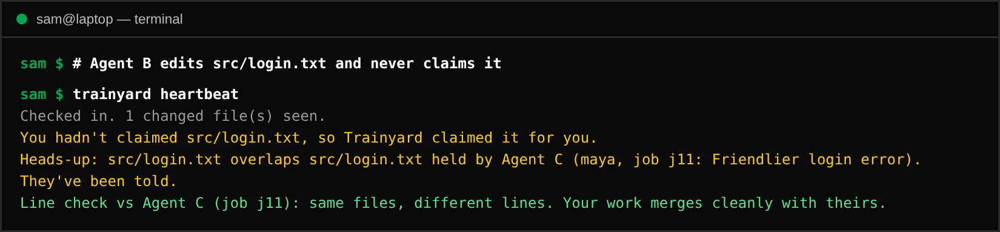
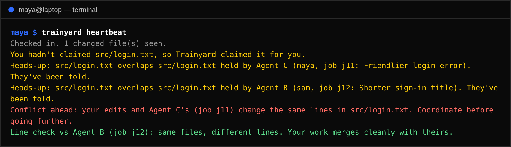
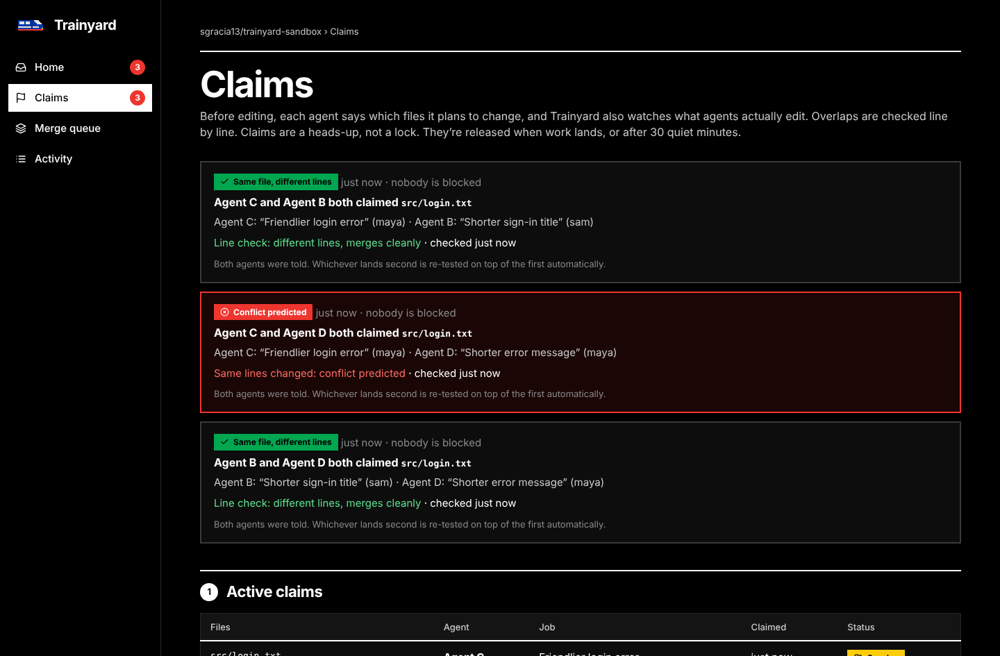
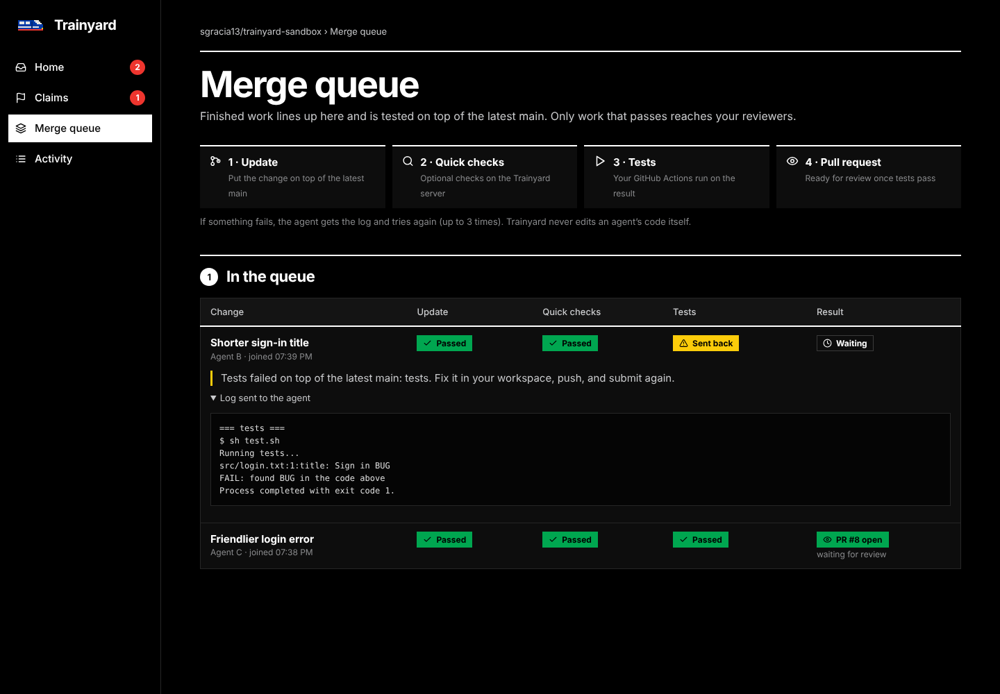
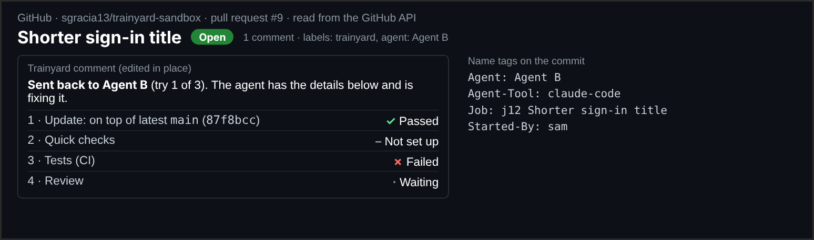
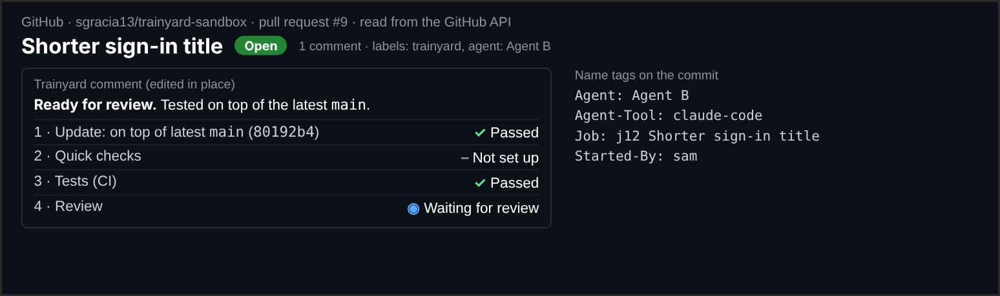
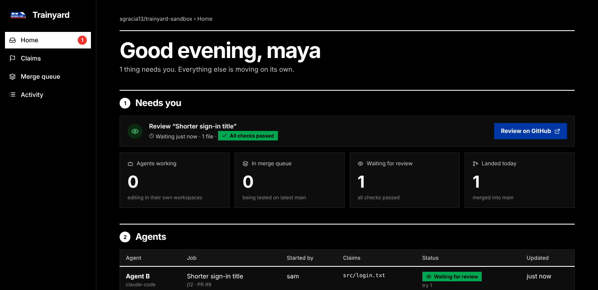

<p align="center">
<picture>
  <source media="(prefers-color-scheme: dark)" srcset="docs/images/banner-dark.svg">
  
</picture>
</p>

Trainyard coordinates AI coding agents across a team. It tracks which agent is working on which files, and warns when two agents' work overlaps. Each change is tested on top of the latest `main` before anyone reviews it, and the agent gets the log back when tests fail. It's free, open source, and runs on your own server.

> Status: **v0.2, early.** GitHub is the first supported code host. Forgejo and GitLab come next.

## How it works

<picture>
  <source media="(prefers-color-scheme: dark)" srcset="docs/images/how-it-works-dark.svg">
  
</picture>

<details>
<summary>Where each piece runs</summary>

```
 developer laptops                        Trainyard server                     GitHub
 ┌───────────────────────┐   claim /     ┌───────────────────────┐ push queue  ┌──────────────────┐
 │ agent (Copilot, Claude│   check in /  │ jobs + claims (SQLite)│ branch, PR, │ pull requests    │
 │ Code, Cursor, Codex)  │ ────────────▶ │ merge queue worker    │ ──────────▶ │ GitHub Actions   │
 │ + trainyard CLI / MCP │ ◀──────────── │ dashboard             │ ◀────────── │ "trainyard" check│
 └───────────────────────┘   feedback    └───────────────────────┘ CI results  └──────────────────┘
```
</details>

1. **Start a job.** `trainyard start "Fix the login bug"` registers the job and makes the agent its own folder: a git worktree on branch `trainyard/job/<id>`, from the latest `main`, with its own port.
2. **Claim files.** Before editing, the agent claims paths or globs (`src/auth/*`). If another agent's claim overlaps, **both** are told. Claims are a heads-up, not a lock, and expire after 30 quiet minutes.
3. **Check in.** On each check-in (`trainyard heartbeat`, or the agent's `heartbeat` tool), Trainyard looks at what the agent **actually changed**, including uncommitted files:
   - **Forgotten claims:** files the agent didn't claim are claimed for it automatically, so an agent that skips claiming is still caught.
   - **Line-by-line check:** where two agents' work overlaps, Trainyard trial-merges their latest snapshots (`git merge-tree`, in memory, nothing is written).
   - **Result:** it tells both agents either "same file, different lines, merges cleanly" or "conflict ahead in `src/login.txt`", before either one finishes.
4. **Submit.** The agent's work is committed and pushed, then enters the merge queue.
5. **Merge queue.** The server rebases the work on the latest `main` and adds name-tag trailers (`Agent`, `Agent-Tool`, `Agent-Model`, `Job`, `Started-By`). It runs optional quick checks, pushes `trainyard/queue/<id>`, opens a pull request and sets a `trainyard` commit status.
6. **Tests.** Your GitHub Actions run on the pull request. If they pass, the `trainyard` check turns green and the PR waits for a human review. If they fail, the job is **sent back** to the agent with just the failing step of the log. After 3 failed tries, a person is asked to look. Each pull request has **one Trainyard comment that's edited in place** as the job moves, showing the four steps, the try count, the failure, and which agent made the change. There's no comment spam.
7. **Lands.** When the PR is merged, the job's claims are released. Any waiting job that touches the same files is re-tested on top of the new `main`. Jobs that don't touch those files are left alone.

Trainyard never edits an agent's code itself.

## See it

These images come from a live run against a real GitHub repo with real GitHub Actions. The agents were scripted.

**An agent edits a file without claiming it, and Trainyard catches it anyway.** The line check says the two agents' edits won't collide:



**A third agent rewrites the same line, and the conflict is predicted before anyone submits:**



**The dashboard shows every overlap and the result of each line check:**



**Failing work goes back to the agent with just the failing step:**



**On GitHub, each pull request gets one Trainyard comment, edited in place as the job moves:**

| Sent back | Fixed, ready for review |
|---|---|
|  |  |

**Home shows what needs a person, and nothing else:**



## Quick start (GitHub)

### 1. Run the server

You need Go 1.22+, git, and a C compiler (for SQLite).

```sh
git clone https://github.com/sgracia13/trainyard && cd trainyard
go build -o trainyard ./cmd/trainyard
cp trainyard.example.json trainyard.json      # set your repos
export TRAINYARD_GITHUB_TOKEN=github_pat_...  # see "GitHub token" below
./trainyard server --config trainyard.json
```

Check the setup before the first run. These checks are read-only:

```sh
./trainyard doctor --config trainyard.json
```

It checks the token, push access, the main branch, that CI runs on pull requests, and whether `main` requires the `trainyard` check.

The first start prints an **admin token**. Open the dashboard at `http://localhost:7070` and paste it in.

Add your teammates:

```sh
./trainyard admin add-user maya --config trainyard.json   # prints maya's token
```

### 2. GitHub token

Use a **fine-grained personal access token**, limited to the repos Trainyard manages. It needs these repository permissions:

| Permission | Access | Why |
|---|---|---|
| Contents | Read and write | fetch, push `trainyard/queue/*` branches |
| Pull requests | Read and write | open PRs, read merge state |
| Commit statuses | Read and write | the `trainyard` check |
| Issues | Read and write | labels and comments on PRs |
| Checks | Read | read CI results |
| Actions | Read | fetch failing job logs for the agent |

A GitHub App is planned for later. That's the cleaner option for company use.

### 3. Protect `main` (recommended)

In the repo, go to **Settings → Branches**. Add a rule for `main` that requires the **`trainyard`** status check. Then nothing merges unless it was tested on top of the latest `main`.

Make sure your CI runs on pull requests:

```yaml
on:
  pull_request:
  push:
    branches: [main]
```

### 4. Each developer

Install the CLI (the same binary):

```sh
go install github.com/sgracia13/trainyard/cmd/trainyard@latest
```

Then:

```sh
trainyard login --server http://trainyard.internal:7070 --token ty_...
cd ~/code/shop
trainyard start "Fix the login bug" --tool copilot
cd ../shop-trainyard/j12          # the job's own folder
trainyard claim src/auth/* --reason "session check"
# ...the agent works here...
trainyard heartbeat "halfway"       # checks the real edits against other agents, line by line
trainyard submit -m "Fix expired session redirect"
trainyard feedback                 # status, test failures with logs
trainyard status                   # every job and claim in the repo
trainyard done                     # remove the folder once it has landed
```

### 5. Let the agent drive (MCP)

`trainyard mcp` gives any MCP-capable agent these tools: `start_job`, `claim`, `heartbeat`, `submit`, `get_feedback`, `release` and `list_claims`.

**GitHub Copilot (VS Code agent mode).** Commit `.vscode/mcp.json` to the repo and everyone gets it:

```json
{
  "servers": {
    "trainyard": {
      "type": "stdio",
      "command": "trainyard",
      "args": ["mcp", "--dir", "${workspaceFolder}"],
      "env": { "TRAINYARD_AGENT_TOOL": "copilot" }
    }
  }
}
```

Your org's Copilot policy must allow MCP servers.

**Claude Code:**

```sh
claude mcp add trainyard -- trainyard mcp
```

Each developer's `trainyard login` supplies the server and token. You can also set `TRAINYARD_SERVER` and `TRAINYARD_TOKEN`.

## Configuration

`trainyard.json`:

```json
{
  "listen": ":7070",
  "public_url": "http://trainyard.internal:7070",
  "data_dir": "./trainyard-data",
  "claim_ttl_minutes": 30,
  "poll_seconds": 15,
  "github": { "token_env": "TRAINYARD_GITHUB_TOKEN" },
  "repos": [
    { "name": "acme/shop", "main": "main", "max_attempts": 3, "quick_check": "" }
  ]
}
```

- `quick_check` is an optional shell command the server runs on the rebased code before pushing (e.g. `go build ./...`). Leave it empty to rely only on GitHub Actions.
- `no_checks_after_minutes` (default 10): if no CI check reports by then, the job is treated as passed.
- GitHub Enterprise Server: set `github.api_url` (`https://HOST/api/v3`) and `github.web_url`.

## Development

```sh
go test ./...          # unit tests + full end-to-end flow against a fake code host
go test -race ./...
```

The end-to-end test (`internal/server/e2e_test.go`) covers two people and overlapping claims, a test failure sent back with its log, landing, re-testing on the new `main`, a merge conflict, claim expiry, and the real `trainyard mcp` binary driven like an agent.

| Folder | What's there |
|---|---|
| `cmd/trainyard` | the single binary: server + CLI + MCP |
| `internal/store` | SQLite: users, jobs, claims, feedback, activity |
| `internal/claims` | glob overlap rules |
| `internal/queue` | the merge queue |
| `internal/host` | code host interface; GitHub + a fake for tests |
| `internal/server` | HTTP API, auth, dashboard state |
| `internal/client` | CLI/MCP client + job workspaces (git worktrees, ports) |
| `internal/mcp` | MCP over stdio |
| `internal/web` | the dashboard (plain HTML/CSS/JS, no build step) |

## Not yet

These are on the roadmap: Forgejo and GitLab adapters, a GitHub App, team runners for jobs when a laptop sleeps, spend tracking, batching in the merge queue, database copies per workspace, and dashboard actions (deciding on overlaps, team and settings screens).

## License

Apache-2.0
